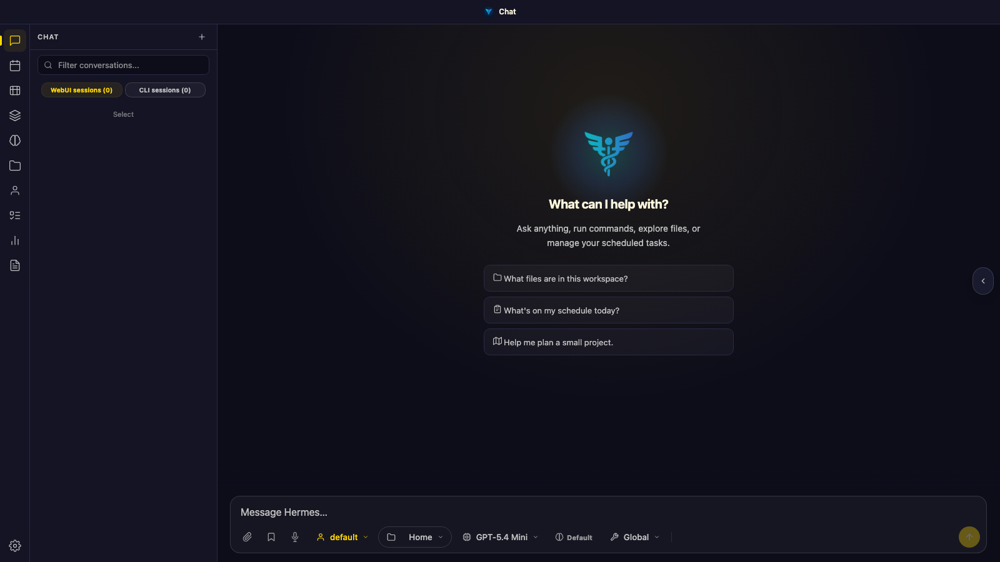
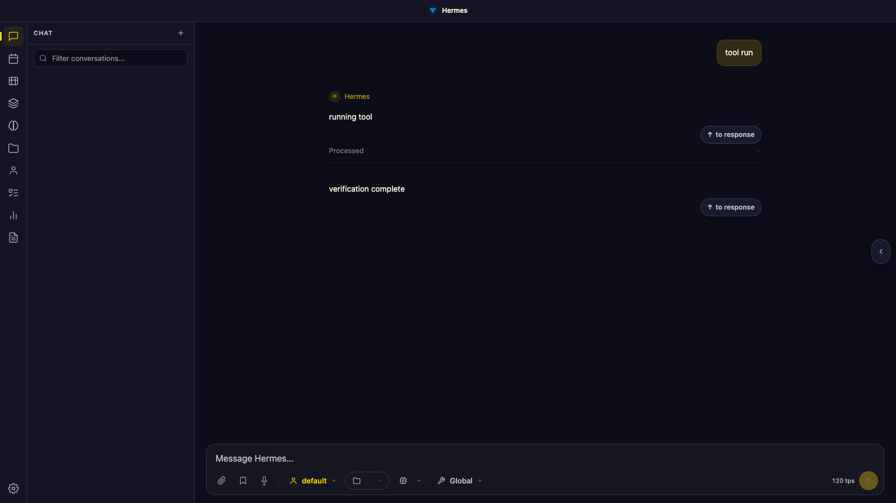
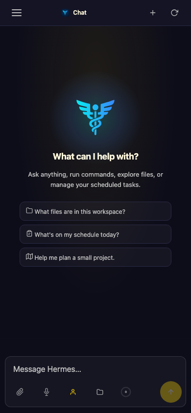
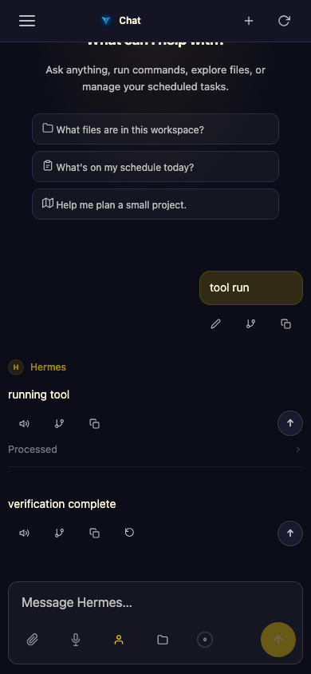

# PR #7 — generation-only composer TPS evidence

## Scope and provenance

- Before: untouched base `cab0853ba055f4c371fef8538146e9406c257231`.
- After capture: `b4b6f7169c091ff63de979718a7473042f74d56d`. The generator/UI behavior was exercised at `6b524b3b204dfcd07233e8bcd871f243d9f2ebd9`; `b4b6f7169` adds only copied test-field lists and removal of one blank line.
- This commit adds this reproducible evidence, not product behavior.
- Synthetic metadata and isolated, agent-free loopback servers only. No real conversations, credentials, provider calls, production sessions, or reload of production state. The text `running tool` labels a synthetic assistant/tool row; it is not an executed shell command.

## Comparison

| Viewport | Before (base) | After (generation throughput) |
|---|---|---|
| 1600 × 900 desktop |  |  |
| 390 × 844 mobile |  |  |

## Observed assertions

- The base has no `#composerTps` element.
- An interim assistant tool row followed by a final assistant row with `_turnGenerationRecorded: true` and `_turnGenerationTps: 120` produces `120 tps` immediately before `#ctxIndicatorWrap`. A deliberately legacy `_turnTps: 8400` on the same row does not leak into the composer.
- Appending `/title`-style unmarked local output and separately a `/status`-style `_ephemeral`/`_statusCard` row retains `120 tps`. These are not real completed model turns.
- `#composerTps.nextElementSibling === #ctxIndicatorWrap`.
- At 390px the metric hides with the context widget, the sidebar is closed, the composer is fully visible, and `scrollWidth === innerWidth === 390`.
- A separate real-worker (synthetic Agent) settlement probe measured 300 output tokens across 4s + 8s of API calls and returned `25.0` in both `done.usage.tps` and persisted `_turnGenerationTps`, with the rollout marker and original rolling caps restored. Whole-turn wall time was much longer.

## Limits

These are metadata-driven render checks and an isolated worker probe, not proof of a live provider turn or production activation. The local full-suite attempts did not complete; focused/neighboring tests were used instead. The GitHub workflows target `master`, not the approved `brent-deployment` destination, so no pull-request CI is reported on this fork destination. The target branch has no required status checks or rules.

Later cleanup only updates the five copied field-list fixtures and removes a whitespace line; it does not change generation math, composer behavior, or these captured values.

## Reproduce

Serve this checkout at loopback port 59901 with isolated state and Playwright/Chromium available in the test interpreter. Then run:

```sh
WEBUI_PORT=59901 CAPTURE_PREFIX=composer-tps   python docs/pr-media/7-turn-generation-tps/capture.py
```

For the base comparison serve base `cab0853ba055f4c371fef8538146e9406c257231` on port 59902 and use `CAPTURE_PREFIX=composer-before`. The helper matches sidebar state at both viewports, closes the mobile sidebar after resizing, and disables animation for the mobile capture.
